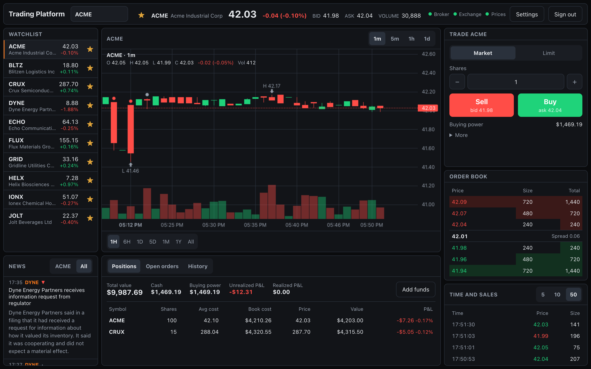
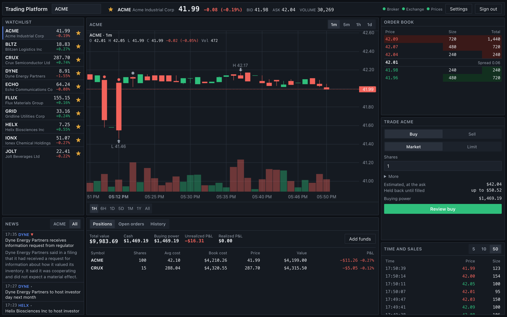
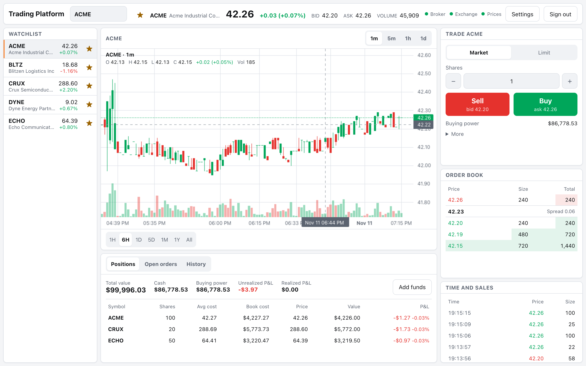
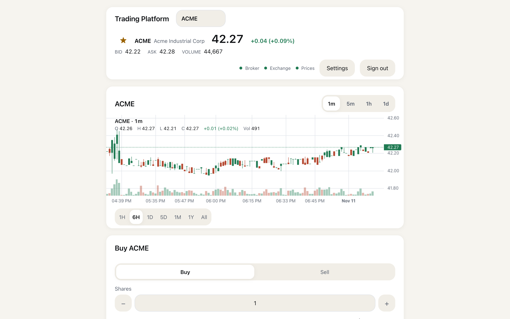
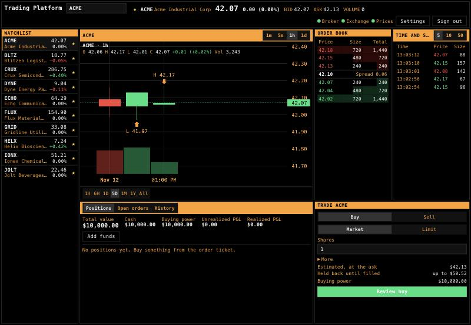

# trading-platform

[](https://github.com/snoopy55619819/trading-platform/actions/workflows/ci.yml)

**A stock market built from scratch, end to end with:**

- **A Rust exchange** with its own matching engine and FIX 4.4 ([Financial Information eXchange protocol](https://fixtrading.org/standards/fix-protocol/)) gateway
- **A broker** with an order management system and a double-entry ledger
- **A live market data feed**, sequenced, with gap recovery
- **Simulated trading firms** that keep the market moving
- **A browser trading app** with multiple UI themes

Entirely synthetic: no real market data, no real money.



## What it is

The whole life of a trade, end to end:

1. You place an order in the browser.
2. The broker checks it against your buying power and sends it over FIX to the exchange.
3. The matching engine fills it against orders from simulated market makers and traders.
4. The fill comes back to the broker's ledger, and your holdings update.
5. The public feed moves the book and chart for everyone watching.

Each part is a separate business with its own code, language and database, connected only
by published protocols, the way real market infrastructure is.

### Highlights

- **Matching engine:** matches orders in memory with price-time priority. Each day starts
  from a snapshot, and replaying the day's journal rebuilds the exact same order book.
- **FIX 4.4:** written by hand on both sides (Rust exchange, TypeScript broker) and tested
  against QuickFIX/Go, an independent FIX engine. Survives the exchange being killed
  mid-session without losing a fill.
- **Market data:** every message is numbered, so a subscriber can detect a missed message
  and recover from a fresh snapshot.
- **Ledger:** double-entry bookkeeping where Postgres itself rejects an entry that does not
  balance.
- **Crash safety:** a broker killed mid-trade loses no orders and books no fill twice.
- **Simulated market:** market makers and traders keep prices moving, connecting over the
  same FIX session as any other client.
- **Trading app:** React App with live prices, charts, order book, order confirmations, and positions with P&L, in four styles with light and dark modes.

One set of components, four styles, each in light and dark (Terminal is dark only):

| Pro | Active | Calm | Terminal |
|:---:|:---:|:---:|:---:|
|  |  |  |  |
| dense, everything at once | bold, quick to trade | spacious, one thing at a time | a market data terminal: black, amber, monospace |

### What's inside

| Component | Language | What it does |
|---|---|---|
| `exchange-alpha/` | Rust | matching engine, FIX 4.4 gateway, market data publisher |
| `broker/backend/` | TypeScript (Node) | API, order management, pre-trade risk, ledger, FIX initiator |
| `broker/market-data/` | TypeScript (Node) | live price fan-out to browsers, candle history |
| `broker/web/` | TypeScript (React, Vite) | the trading app |
| `participants/simulator/` | TypeScript (Node) | simulated trading firms |
| Postgres | SQL | one database per service, never shared |

Each top-level folder is a separate business: the exchange, the broker, and the simulated
trading firms. They share no code and connect only through what the exchange publishes (its
FIX spec and market data schema), the way real firms do. How those published specs are
versioned and copied is in [DECISIONS.md](docs/DECISIONS.md#9-specs-and-codegen).

## Architecture

### Current Implementation (MVP)

To keep scope manageable the broker runs as one backend process and the exchange as one binary. 

[](https://snoopy55619819.github.io/trading-platform/architecture/current-plan.html)

### Long-Term Goal

Where the platform is headed: every part becomes its own service, split the way real market
infrastructure is split, and a third plane is added for what happens after a trade (clearing,
custody and settlement). In the diagram, boxes tagged **SPLIT** run together in one process
today, and **dashed** boxes and dotted lines are not built yet.

[](https://snoopy55619819.github.io/trading-platform/architecture/ideal-end-state.html)

The numbered badges are explained in each diagram's legend. Open the interactive versions,
with the full legend and a light/dark toggle: [current plan](https://snoopy55619819.github.io/trading-platform/architecture/current-plan.html) and
[ideal end state](https://snoopy55619819.github.io/trading-platform/architecture/ideal-end-state.html). Click either image to open it too. The source
is `docs/architecture/*.html`.

## Key design choices

- **Two separate data paths.** Orders and fills travel privately between one customer and the
  exchange (blue in the diagrams). Prices travel publicly to everyone (orange). A trade reaches
  you both ways: privately as your fill, and publicly as an anonymous trade on the feed.
- **The public feed cannot leak who traded.** Its trade message has no field for an account or
  order ID, so a leak can't even be written, rather than merely being avoided.
- **Split only where it pays off.** The broker's API, order management and ledger run in one
  process, so checking buying power and recording the order happen in a single database
  transaction. Market data is its own service because its work is different: constant writes
  and its own database.
- **The browser joins the two paths itself.** It gets positions from the broker's backend and
  prices from market-data, so the backend never depends on market data.

## Running it

With Docker, Rust, Node 26 and pnpm installed, and the first-time setup done once, one command
starts everything: the databases, the exchange, the simulated market, the broker and the web
app.

```bash
pnpm dev
```

Then open http://localhost:5173, open an account (it starts with $10,000.00 in cash) and place an order.

First-time setup, troubleshooting, running one service on its own, and every shortcut from the
repo root are in [RUNNING.md](docs/RUNNING.md). The plan for running it publicly is in
[DEPLOYMENT.md](docs/DEPLOYMENT.md).

## Roadmap

The MVP, milestones 0 to 8, is built, each milestone proved by a concrete test. Next is the
post-trade plane: clearing, custody and settlement on a real T+1 clock. What each milestone
built and proved, what comes after, and where each service's checklist lives are in
[ROADMAP.md](docs/ROADMAP.md).
