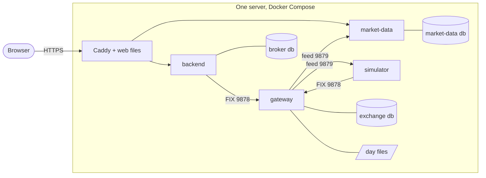

# Deploying the trading platform

The plan for running the platform publicly as a live demo, at **`tradeplatform.dev`**: what
gets deployed, where, and how a change gets from `main` to the server. **In progress:** the
images and compose files are built and run locally (stage 1), every PR and merge is checked
by CI (stage 2), and the deploy workflow and server setup are written (stage 3); the AWS
resources and the first release come next ([AWS-SETUP.md](AWS-SETUP.md)). Why one server with Docker
Compose rather than two servers, Kubernetes or managed services is in
[ADR 0003](adr/0003-one-server-with-docker-compose.md). Running it locally is in
[RUNNING.md](RUNNING.md).

## The layout

One AWS EC2 server, a `t4g.small` (2 vCPU, 2 GB of memory, ARM) running Amazon Linux 2023,
in `us-east-2` (Ohio), running Docker Compose. The AWS project the site lives in only
allows `us-east-2`; it costs the same as `us-east-1`. Only
[Caddy](https://caddyserver.com/) is reachable from the internet. It gets an HTTPS
certificate by itself and routes by path on **one hostname**:

```
https://tradeplatform.dev/        ->  the web client's files
https://tradeplatform.dev/api/... ->  backend :8080       (Caddy strips /api)
https://tradeplatform.dev/md/...  ->  market-data :8081   (Caddy strips /md; includes the WebSocket)
```

One hostname means one DNS record and one certificate, and because the web client and both
APIs share an origin, browsers make no cross-origin (CORS) checks. The web client is built
with path-only URLs (`/api`, `/md`), so the same image works on any hostname, locally too.

**The domain** is registered at Cloudflare, which also serves its DNS: one `A` record
pointing at the server's Elastic IP, set to "DNS only" (not proxied) so Caddy gets and
renews its own Let's Encrypt certificate. `.dev` names only work over HTTPS, which Caddy
provides.



- **Each company deploys itself,** from its own compose file: `exchange-alpha/deploy/`,
  `participants/simulator/deploy/` and `broker/deploy/`. All three join one shared Docker
  network, so containers reach each other by name (`gateway:9878`), on the same published
  ports any client uses.
- **Nothing private is published.** The gateway, the databases and the simulator have no
  ports open to the internet; the security group allows only 443 and 80 (for certificate
  renewal).

## What each process needs

Every process already reads its settings from environment variables, so nothing in the code
changes to deploy it.

| Process | Settings |
|---|---|
| gateway | `DATABASE_URL`, `ALPHA_DATA_DIR`, `ALPHA_LISTEN` and `ALPHA_MD_LISTEN` (`0.0.0.0:…` inside its container), `ALPHA_COMP_IDS` |
| simulator | `SIM_FIX_HOST=gateway`, `SIM_FEED_URL=ws://gateway:9879`, `SIM_ACTIVITY=0.2` for a quieter market |
| backend | `DATABASE_URL`, `FIX_HOST=gateway`, `FIX_PORT=9878`, `BROKER_WEB_ORIGIN=https://tradeplatform.dev` |
| market-data | `MD_DATABASE_URL`, `MD_FEED_URL=ws://gateway:9879` |
| web (at build time) | `VITE_BACKEND_URL=/api`, `VITE_MARKET_DATA_URL=/md`: paths, so the image works on any hostname |

**Health checks**, so compose starts things in order:
- Postgres: `pg_isready`;
- gateway: its FIX port accepting connections;
- backend: `GET /status`;
- market-data: `GET /health`.

**Memory**, measured with the whole stack running locally in Docker: about 350 MB at start
(backend 80 MB, market-data and the simulator about 58 MB each, three Postgres about 40 MB
each, Caddy 30 MB, the gateway 4 MB). It grows as the databases warm their caches, but a
2 GB server has plenty of room, with a 2 GB swap file as a safety net. Measure again after a
few days live.

## AWS services and cost

Estimated for us-east-2 (Ohio), November 2026. Prices change; check the totals in the
[AWS Pricing Calculator](https://calculator.aws/) before relying on them.

| Service | How many | What for | Per month |
|---|---|---|---|
| EC2 `t4g.small` | 1 | runs everything | ~$12.30 |
| EBS gp3, 30 GB | 1 volume | the server's disk: databases, day files, images | ~$2.40 |
| Public IPv4 (Elastic IP) | 1 | a fixed address for DNS; AWS charges for every public IPv4 | ~$3.65 |
| S3 | 1 bucket | nightly database dumps and the exchange's old day files | < $1 |
| CloudWatch | a disk-usage metric, its alarm, a billing alarm | warnings before the disk or the bill gets out of hand | ~$0.30 |
| Systems Manager | | shell access and one-off commands without SSH | $0 |
| Data transfer out | | the first 100 GB a month is free; a demo uses far less | $0 |
| **Total** | | | **≈ $19** |

Plus the domain, paid to Cloudflare at about $12 a year, whose DNS is free.

Not needed: Route 53 (Cloudflare serves the DNS), a load balancer (Caddy routes),
certificates from ACM (Caddy uses Let's Encrypt for free) and ECR (images live in the
GitHub Container Registry).

**Ways to pay less:** a 1-year Savings Plan takes about 30 to 40% off EC2, and new accounts
get sign-up credits for the first months.

**Alternatives.**

| Option | Per month | Trade-off |
|---|---|---|
| Two servers, split by company (the planned next step) | ≈ $39 | shows the company split; more to set up (see below) |
| AWS Lightsail, 2 GB plan | ≈ $14 | simplest AWS setup; disk, transfer and IPv4 included; less control over networking |
| Hetzner | ≈ €5 to €8 | cheapest; not AWS |
| Fully managed AWS (load balancer, 3 × RDS, Fargate) | ≈ $110 to $130 | nothing to patch, but five to six times the cost |

## Images

Five Dockerfiles, each in its own folder. There is still no shared build.

- **Exchange** (`exchange-alpha/Dockerfile`): a two-stage build. Compile with the Rust image,
  then copy the binary into a small Debian slim image.
- **Backend, market-data, simulator:** `node:26.8.1-slim` plus `pnpm install --prod`. No
  build step: Node runs `.ts` directly, as it does locally. market-data and the simulator
  generate the feed's types from the vendored proto in a first stage. The backend and
  market-data apply pending migrations each time they start; the backend's security master
  seed stays a deliberate, manual step.
- **Web** (`broker/web/Dockerfile`): build with `vite build` in one stage, then copy the files
  into a Caddy image along with the broker's `Caddyfile`. That one container is the broker's
  front door: the site, `/api` and `/md`.

Images go to the GitHub Container Registry (free for public repositories), tagged with the
git commit they were built from, and built for `linux/arm64` on GitHub's ARM runners, since
the server is ARM.

## Trying the production stack locally

The same images and compose files run on a laptop, with plain HTTP on port 8000. Nothing
else is published, so it runs alongside `pnpm dev`.

1. Create each company's settings from its example, with real passwords
   (`openssl rand -hex 24`): `exchange-alpha/deploy/.env` and `broker/deploy/.env`. For
   the broker, locally: `SITE_ADDRESS=:80`, `SITE_ORIGIN=http://localhost:8000`,
   `HTTP_PORT=8000`, `HTTPS_PORT=8443`.
2. Make the shared network once, then start each company:

   ```bash
   docker network create trading
   docker compose -f exchange-alpha/deploy/compose.yml up -d --build --wait
   docker compose -f participants/simulator/deploy/compose.yml up -d --build
   docker compose -f broker/deploy/compose.yml up -d --build --wait
   ```

3. Seed the security master, once:

   ```bash
   docker compose -f broker/deploy/compose.yml run --rm --no-deps backend node scripts/seed-securities.mjs
   ```

4. Open http://localhost:8000. Stop with `docker compose -f <file> down` for each; add `-v`
   to delete that company's data too.

On the server it is the same, with the production `.env` values and the images pulled from
the registry instead of built.

## From merge to running

Merging and deploying are separate, so a busy day of merges does not mean a busy day of
deploys.

1. **Every PR, and every merge to `main`: `ci`.** GitHub Actions runs each deployable's tests
   and typechecks. The Rust tests need nothing else; the backend's and market-data's tests
   need Postgres, which runs as a service container in the job. Nothing is deployed.
2. **Deploy when you choose: `deploy`.** Push a version tag (`git tag v0.3.0 && git push
   origin v0.3.0`), or press "Run workflow" on the `deploy` workflow in GitHub and give a
   version. The tag names exactly what is live.
3. **Build.** The five images are built for that commit on GitHub's ARM runners and pushed,
   tagged with the version.
4. **Release.** The workflow moves a git tag, `live`, to that commit. **GitHub never
   connects to the server and holds no AWS credentials.** Instead the server's deploy agent
   ([`hosting/deploy-agent.sh`](../hosting/deploy-agent.sh), every minute) notices `live`
   moved, checks out that version and runs `docker compose pull && docker compose up -d`
   for each company, the exchange first. Only containers whose image changed restart, and
   the backend and market-data apply pending migrations as they start. The workflow then
   waits until https://tradeplatform.dev/version.txt reports the new version.
5. **What a restart does.** A gateway restart loads the day's snapshot and journal in
   seconds; the broker reconnects and recovers anything it missed by resend, and the
   simulator cancels and re-quotes. A backend restart signs everyone out.
6. **Roll back** by running `deploy` again with the previous version. Its images are already
   built, so nothing is rebuilt; `live` simply moves back.

A pull rather than a push, because the project's AWS organization does not allow the
identity provider GitHub would need to sign in to AWS, and because pulling is simpler
anyway: no credentials in GitHub, no inbound connection to the server.

## Secrets and access

- **No SSH.** Port 22 stays closed. A shell, or a one-off command such as the first seed, is
  through Systems Manager.
- **No AWS keys anywhere.** GitHub needs none (the server pulls), and the server reaches AWS
  through its own instance role.
- **Database passwords** are generated on the server at first boot and live only in a
  `.env` file per company there, readable only by root.
- **Sign-in sessions** are random tokens in the backend's memory, so there is no signing key
  to manage.

## Backups and upkeep

- **Nightly:** `pg_dump` each of the three databases to S3. A lifecycle rule deletes dumps
  older than 30 days.
- **Nightly:** copy the exchange's finished day files (every snapshot and journal except the
  newest pair) to S3, then delete local copies older than a week. The gateway only ever reads
  the newest pair and never deletes anything itself. At the simulator's default activity
  that is about 3 GB a month in S3.
- **Disk alarm:** a CloudWatch alarm when the disk passes 80%. market-data's `ticks` grow
  about 13 MB a day and are kept on purpose; how to move old ones rather than delete them is
  in [BACKLOG.md](BACKLOG.md).
- **Uptime:** a free checker (UptimeRobot or Better Stack) on the site, `/api/status` and
  `/md/health`.
- **Server:** automatic security updates.
- **Spend:** a CloudWatch billing alarm, set up before anything else.

## Next step: two servers

Planned once one server is running. The exchange (gateway, its database, the simulator)
moves to a second, private server; the broker stays on the first; the web client moves to
S3 and CloudFront. The broker then reaches the exchange over AWS's private network, the way
a real broker reaches a venue, and each half gets its own memory. About $39 a month in all.

What changes:

- a second `t4g.small` with a 20 GB disk and a public IPv4 address for outbound traffic only
  (pulling images, updates; a NAT gateway instead would cost about $33 a month). Its
  security group allows nothing in except 9878 and 9879 from the broker server;
- three settings point at the exchange server's private address instead of `gateway`:
  `FIX_HOST`, `MD_FEED_URL` and the simulator's host;
- the exchange's and the simulator's compose files move to the new server unchanged;
- the web client becomes an S3 bucket behind a CloudFront distribution with an ACM
  certificate, uploaded by CI instead of built into the Caddy image;
- deploys target two servers, the exchange first.

No code changes: every process already finds the others through settings.

## To do

In the repo:

| | |
|---|---|
| Five Dockerfiles | done (stage 1): exchange, backend, market-data, simulator, web (with Caddy) |
| Three compose files and a `Caddyfile` | done (stage 1): `exchange-alpha/deploy/`, `participants/simulator/deploy/`, `broker/deploy/`, `broker/web/Caddyfile` |
| GitHub Actions: `ci` | done (stage 2): `.github/workflows/ci.yml` |
| GitHub Actions: `deploy` and the deploy agent | done (stage 3): `.github/workflows/deploy.yml`, `hosting/` |
| Nightly scripts | database dumps, and archiving the exchange's day files |

In AWS, once. The steps, as commands, are in [AWS-SETUP.md](AWS-SETUP.md).

| | |
|---|---|
| Account | done: MFA, and the `trading-platform-monthly` budget |
| IAM | an instance role for the server (Systems Manager; S3 in stage 4) |
| Server | a `t4g.small` on Amazon Linux 2023 in `us-east-2`, set up by `hosting/server-setup.sh`; a security group allowing 443 and 80 |
| S3 | a bucket for backups and archived day files, with lifecycle rules |
| DNS | in Cloudflare: an `A` record for `tradeplatform.dev` to the server's Elastic IP, "DNS only" |
| Monitoring | a disk alarm and an uptime checker |
